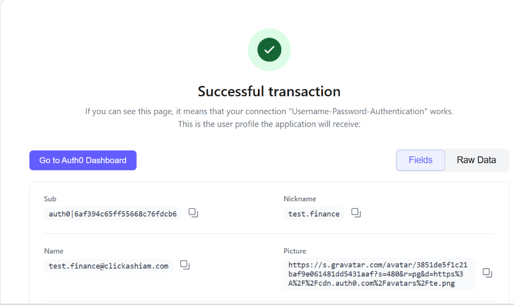

# IAM Lab

I'm learning Identity and Access Management (IAM) and preparing for SC-300.

I started this repo to document what I'm building, not just what I'm watching.

## Lab Setup

I tried to set up a Microsoft 365 E5 developer tenant first, but it asked for a corporate email which I don't have. Same with Okta. so I start researching Googleing and found another options. 

So I started with Auth0 instead. It lets me sign up with Gmail and practice the same IAM concepts: users, roles, MFA, and SSO.

Tenant: clickashiam (Auth0)

## What I Did - Day 1

- Created Auth0 tenant
- Created 2 test users:
    - test.finance@clickashiam.com
    - test.it@clickashiam.com
- Turned on MFA

## What I Learned

- How to create users in an identity platform
- MFA is not just an extra step, it is what stops password attacks
- Setting up a lab is harder than the actual IAM work sometimes

## Day 2 
  On day 2 I was working on my LAB that 
- Changed password for test users and tested login - SUCCESS
- Created roles: Finance-User, IT-Admin
- Assigned Finance-User to finance test user, IT-Admin to IT test user using an Asign User 
- Tested Username-Password-Authentication connection - Successful transaction
- Learned: A successful login means authentication works, roles control what the user can access after

## Day 3
- Deleted duplicate apps and created 1 clean app: Finance-App-Test
- Turned ON Username-Password-Authentication connection for the app
- Tested login through app with finance user - Successful transaction
- Learned: SSO means one login gives access to an app. Duplicate apps cause confusion, cleaning them up is part of IAM governance.
- 

Keep going for myself God is always with me 

- Create roles and assign them to users
- Connect an app with SSO
- Later, practice the same things in Microsoft Entra using 【entity-Microsoft Learn¦canonical_name=Microsoft Learn】 sandbox
