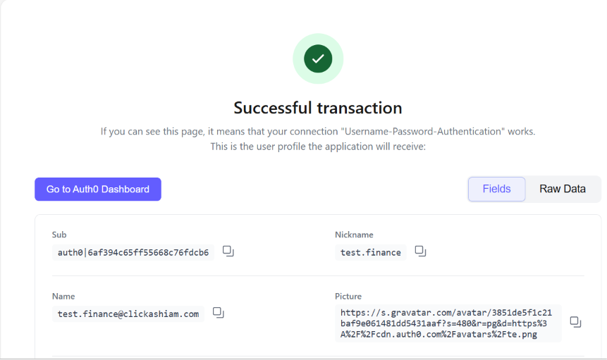
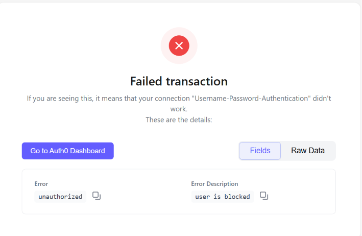
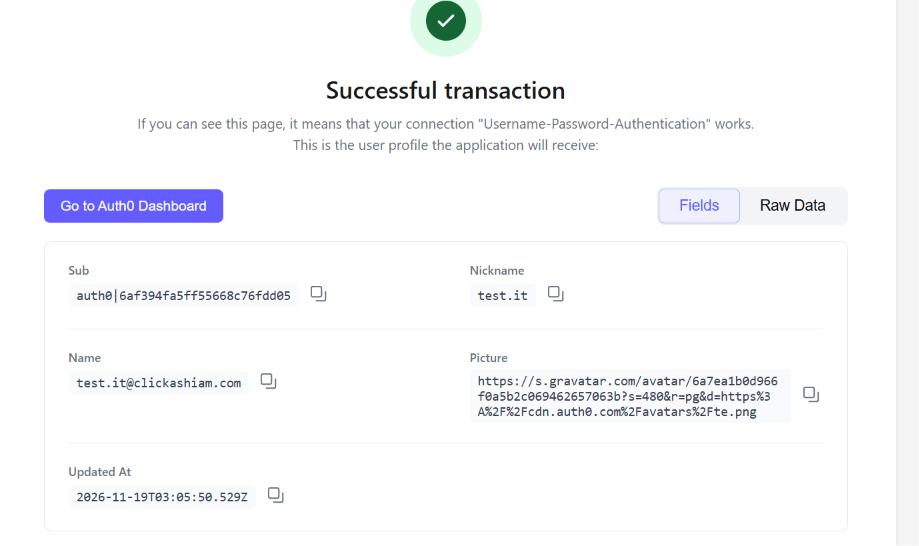
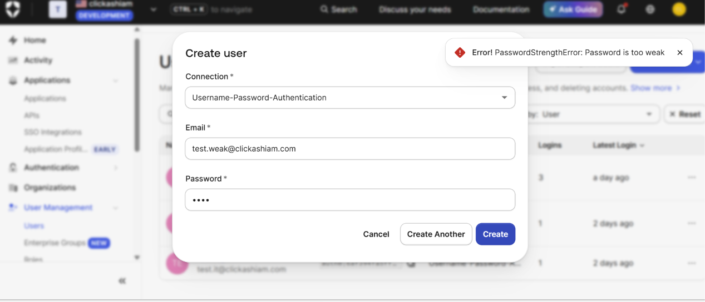
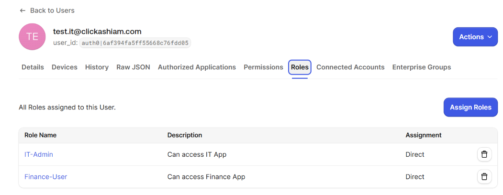
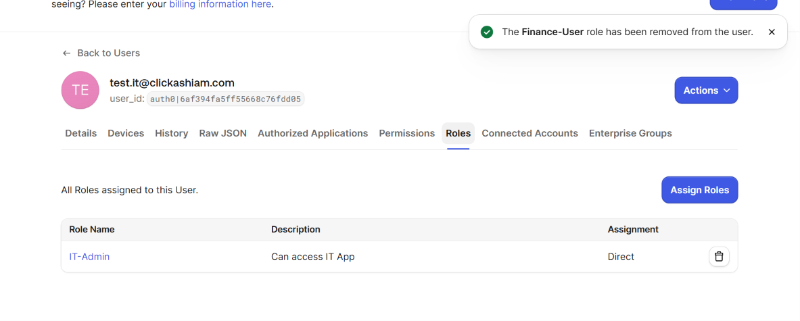
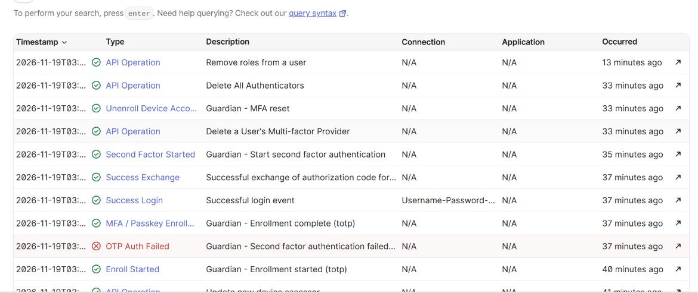
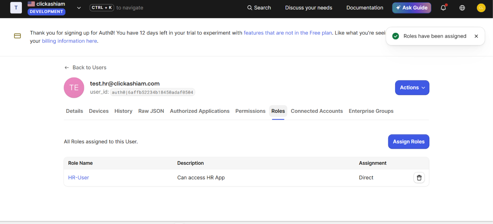
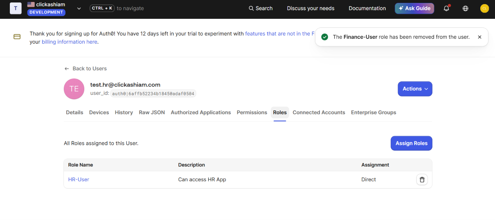

# My IAM Lab - Auth0 + SC-300
# IAM Lab - Joiner-Mover-Leaver | SC-300 + Auth0

**Tenant:** clickashiam (Auth0) | **【entity-GitHub¦canonical_name=GitHub】:** click_ashe/entra-id-iam-lab

## Project 1 - Joiner-Mover-Leaver - COMPLETE ✅
## Project 2 - MFA + Password Policy + Access Review - COMPLETE ✅
## Project 3 - Secure App Onboarding + Separation of Duties - IN PROGRESS

## Project 1 - What I Built
I built a Joiner-Mover-Leaver (JML) lab in Auth0 to prove I can manage the full user lifecycle.

| Step | What I Did | Proof |
|---|---|---|
| Joiner | Created users, assigned Finance-User / IT-Admin roles | Day 2 + Day 4 |
| Mover | Removed old role + Added new role when user changed team | Day 5 |
| Leaver | Blocked user (IT-Admin)- login failed even with correct password | Day 6 |

## Proof Screenshots

## What I Learned from Day 1 to 6 
- Authentication = proving who you are (login + MFA) answering WHO
- Authorization = what you can access after login (Roles) answering WHAT
- RBAC = Role-Based Access Control
- JML = Joiner gets access, Mover changes access, Leaver loses access

---
## My Daily Log Below
# IAM Lab

I'm learning Identity and Access Management (IAM) and preparing for SC-300.

I started this repo to document what I'm building, not just what I'm watching.

## Lab Setup

I tried to set up a Microsoft 365 E5 developer tenant first, but it asked for a corporate email which I don't have. Same with Okta. so I start researching Googleing and found another options. 

So I started with Auth0 instead. It lets me sign up with Gmail and practice the same IAM concepts: users, roles, MFA, and SSO.

Tenant: clickashiam (Auth0)

## Day 1

- Created Auth0 tenant
- Created 2 test users:
    - test.finance@clickashiam.com
    - test.it@clickashiam.com
- Turned on MFA

## What I Learned

- How to create users in an identity platform
- MFA is not just an extra step, it is what stops password attacks
- Setting up a lab is harder than the actual IAM work sometimes

## Day 2 
  On day 2 I was working on my LAB that 
- Changed password for test users and tested login - SUCCESS
- Created roles: Finance-User, IT-Admin
- Assigned Finance-User to finance test user, IT-Admin to IT test user using an Asign User 
- Tested Username-Password-Authentication connection - Successful transaction
- Learned: A successful login means authentication works, roles control what the user can access after

## Day 3
- Deleted duplicate apps and created 1 clean app: Finance-App-Test
- Turned ON Username-Password-Authentication connection for the app
- Tested login through app with finance user - Successful transaction
- Learned: SSO means one login gives access to an app. Duplicate apps cause confusion, cleaning them up is part of IAM governance.
- 

- Create roles and assign them to users
- Connect an app with SSO
- Later, practice the same things in Microsoft Entra using 【entity-Microsoft Learn¦canonical_name=Microsoft Learn】 sandbox

## Day 4
- Tested login as test.it@clickashiam.com - Successful transaction
- Created new user test.norole@clickashiam.com with NO role on purpose
- Tested login for no-role user - Login still succeeded
- Learned: Authentication is proving who you are. Authorization is what you can access. A user can login but still have no access if they have no role.

## Day 5 
Today I Did a lot in day 5 adding, removing and assigning Roles 
- Removed Finance-User role from test.finance user (Mover - left Finance team)
- Assigned IT-Admin role to test.finance user (Mover - joined IT team)
- Assigned Finance-User role to test.norole user (Joiner - now has access)
- Learned: When someone moves team, you must REMOVE old role AND ADD new role. If you only add, they keep old access - that is a security risk. This is Joiner-Mover-Leaver.

## Day 5
- I Removed Finance-User role from test.finance user (Mover - left Finance team)
- Assigned IT-Admin role to test.finance user (Mover - joined IT team)
- Assigned Finance-User role to test.norole user (Joiner - now has access)
- I have Learned: When someone moves team, you must REMOVE old role AND ADD new role. If you only add, they keep old access - that is a security risk. This is Joiner-Mover-Leaver.

## Day 6 - Leaver Test: Disable a User

Step 1: Blocked test.finance@clickashiam.com in Auth0 (Actions > Block User).
Step 2: Tried to login as blocked user - login FAILED with user is blocked.
Step 3: Unblocked user again for lab practice.

What I learned:
Leaver = When someone leaves, block/disable first, don't just remove role.
Blocked user cannot login even with correct password.
Delete is last step, after 30-90 days. Block is first.

## Day 7 - Project 1 Wrap-Up

Added About description: IAM Lab - Joiner-Mover-Leaver with Auth0 | SC-300 Hands-On Project 1
Reorganized README top: Title + JML Table + Proof Screenshots + What I Learned. Kept Day 1-6 notes below.
Cleaned GitHub: Only IAM public, rest private, pinned entra-id-iam-lab. Fixed profile bio to IAM Analyst, not software engineering.
Cleaned LinkedIn: Headline + About + Featured = IAM. Posted Project 1 on LinkedIn.

What I learned:
Recruiters read top 10 seconds. Summary on top, diary below.

PROJECT 1 COMPLETE: Joiner-Mover-Leaver Lab

## Day 8 - Project 2 Start: MFA + Password Policy

Step 1: Password Policy - In new Auth0 dashboard, Password Policy page is no longer in Database > Settings. Tenant uses default Good policy. I proved it by trying weak password 12345 for test.weak - BLOCKED, user not created.
Step 2: Brute-Force Protection - Improved brute force protection is ON (green toggle).
Step 3: MFA - Had to turn ON One-time Password factor FIRST, then set Policy to Always. Auth0 said "at least one factor must be turned on" until I did factor first. Then enrolled test.it with Authenticator app, entered code, login said Successful transaction.
Step 4: Security lesson - I shared MFA QR by mistake, so I reset MFA for test.it after test. If a secret is shared, reset it.

What I learned:
Password Policy stops weak passwords before they are created.
MFA stops login even if password is stolen.
Brute-Force Protection stops attackers trying 1000 passwords.

## Day 9 - Project 2 Finish: Access Review

Access Review - Checked all users:

| User | Roles BEFORE | Finding | AFTER Fix |
|---|---|---|---|
| test.finance@clickashiam.com | IT-Admin | OK | IT-Admin |
| test.it@clickashiam.com | IT-Admin + Finance-User | EXTRA ACCESS - IT should not have Finance | IT-Admin ONLY |
| test.norole@clickashiam.com | Finance-User | OK | Finance-User |

Finding: test.it had 2 roles, could access both IT App and Finance App. Violates Least Privilege.
Fix: Removed Finance-User from test.it. Verified only IT-Admin remains.

MFA Check:
All 3 users show "MFA is enabled for this user" - Policy Always is working.
test.it enrolled yesterday and proved login works, then MFA was reset for security.
All 3 will be asked to enroll on next login.

Logs: Checked Monitoring > Logs - saw failed weak password test + successful MFA login.

What I learned:
Access Review = Check who has what access, remove what they don't need.
Least Privilege = Give only the access needed for the job, nothing extra.
Finding extra access is GOOD - that is the job.

PROJECT 2 COMPLETE: MFA + Password Policy + Access Review

## Day 10 - Project 3 Start: Secure App Onboarding + Separation of Duties

Created new app: HR-App-Test (Single Page Web App, Username-Password-Authentication ON)
Created new role: HR-User - Can access HR App
Created new user: test.hr@clickashiam.com - Assigned HR-User only

Separation of Duties Test:
Gave test.hr a second role Finance-User on purpose = SoD Violation - HR should not have Finance.
Fix: Removed Finance-User. Verified test.hr = HR-User only.

What I learned:
App Onboarding = Create app + Create role + Assign role to right users only.
Separation of Duties = One person should not have 2 conflicting roles that let them approve their own request.
Auth0 does not auto-block SoD in free tier - IAM Analyst must catch it in review.

PROJECT 3 IN PROGRESS

Keep going for myself God is always with me 
